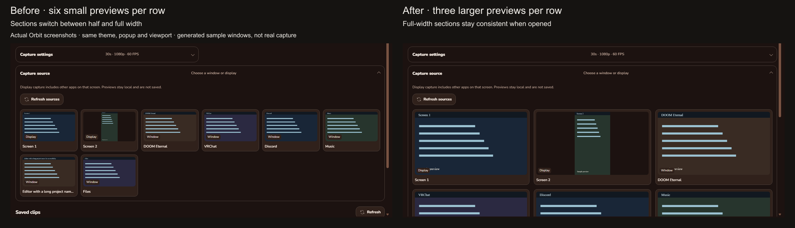

# 0.3.0-dev.6 validation

Installed quietly and unpublished. Capture previews are larger, and opening settings or sources no longer switches sections between columns.

**Before:** six small previews shared a row. Closed sections used half the width, then jumped to full width when opened. A changed source order could rebuild the cards and lose keyboard focus.

**After:** three previews share the same wide popup. The preview image grows from 194 to 414 px wide in the matched fixture. Source thumbnails request up to 640×360 pixels instead of 320×180. Both sections keep their full width, and one main scroll area replaces the nested source scrollbar. Portrait sources remain contained.

Refreshing updates existing cards in place. Existing sources keep their order and focus; new windows append at the end. A closed selected source clears the choice instead of switching capture to another window. Long names remain available through accessible labels and tooltips.

These are actual app screenshots with **generated sample windows**, not captures of the user's desktop or games.

## What passed

- 20 source-picker checks: size, stable expansion, reordered refreshes, selection, focus, new/closed windows, portrait images and a narrow window at 125% zoom. Default and remembered popup frames both stay in place.
- 779 unit checks and 873 packaged app checks; 2 opt-in native-window checks skipped. The existing 26 clipping UI, 13 drag/reopen and 50 shared sizing checks also passed against the final package.
- Installed files match the validated package, including all 33 unpacked native resources. Orbit reopened in the background. The running Geometry Dash and VRChat processes retained their IDs; capture, audio and VR helpers are off.
- A fresh backup and the normal loader verify the current theme, seven custom themes, Afterglow startup, saved preferences, artwork, connections, capture choices and 111 history records with play totals. No separate Orbit-Dev folder was present; no archived profile was merged.

## Limits

No real window, desktop or microphone recording was performed in these checks. This is a source-picker UI repair; the existing recording/audio path is unchanged. Physical source-preview behavior and gameplay performance were not re-tested. No CPU or RAM gains are claimed; larger previews use more thumbnail pixels, and their resource cost was not benchmarked.

## Evidence

- [Retained build comparison](../../../outputs/sources033-before/clips-source-report.json), [final source checks](../../../outputs/sources033-after/clips-source-report.json), [narrow screenshot](validation/0.3.0-dev.6/source-narrow.png).
- [Packaged regression](../../../work/sources033-final-suites.json), [unit log](../../../work/sources033-unit.log), [clipping UI](../../../outputs/sources033-clips-ui/clips-report.json), [drag/reopen](../../../outputs/sources033-polish/clips-polish-report.json), [shared sizing](../../../work/sources033-popup-regression.json).
- [Package verification](../../../work/sources033-package-verification.json), [installed files](../../../work/sources033-install.json), [saved settings](../../../work/sources033-preservation/final.json), [history](../../../work/sources033-preservation/after-live-history.json).
