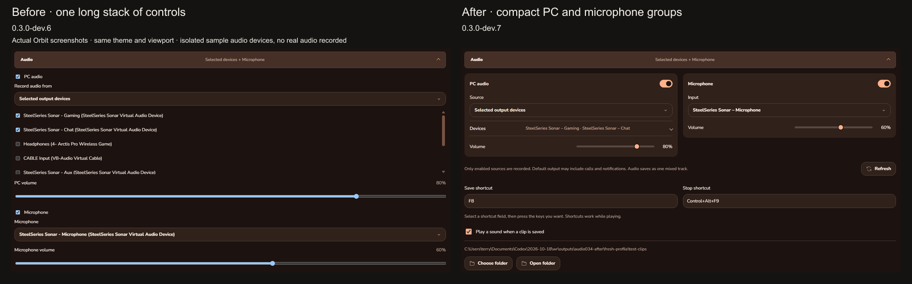
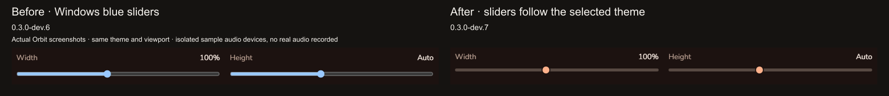

# 0.3.0-dev.7 validation

Installed quietly and unpublished. Recording audio has compact PC and microphone groups, and Desktop sliders now follow the selected theme.

## Audio controls

**Before:** one long stack repeated Microphone labels, displayed lengthy driver names and stretched volume sliders across the popup. **After:** PC audio and Microphone each have their own switch, source choice and short volume row. Groups sit beside each other when space permits and stack at narrow widths.

Apps and Devices expand when needed. Their selected names remain visible when closed. Redundant driver suffixes are shortened; full hardware names remain in tooltips, and saved device IDs are unchanged. Default-output privacy information, mixed-track information and Refresh remain available.

## Shared sliders

**Before:** Width and Height retained Windows' blue range styling inside the chosen theme. **After:** Desktop ranges use the theme accent, rounded tracks and visible keyboard focus. Values, arrow-key interaction and the Auto height label remain intact. Controller Home and Library layouts are unchanged.

These are actual app screenshots with isolated **sample audio devices**. No real audio was recorded to create them.

## What passed

- 17 audio/slider checks: independent switches and volumes, native arrow-key adjustment, saved app/device choices, complete choice lists, full-name tooltips, theme changes, capture-time locking, reopening and narrow layouts at 125% zoom.
- 779 unit checks and 873 packaged app checks. Two opt-in native-window checks were skipped. The final package also passed 26 clipping UI, 20 source-picker, 13 drag/reopen and 50 shared sizing checks.
- Installed files match the validated package and all 33 unpacked native resources. Orbit reopened in the background, with recording, audio and VR helpers off. No games were running at the installation check; none were launched or targeted.
- A fresh backup and the normal loader retained the current theme, seven custom themes, Afterglow startup, selected audio sources and volumes, saved preferences, artwork, connections and all 111 history records with play totals. No separate Orbit-Dev folder was present; archived profiles were not merged.

## Limits

This pass changes the interface, not the recording engine or its audio processing. The user's earlier confirmation that mic and PC audio sound good remains playtest evidence. No physical recording, Windows focus, game-launch or account-authorization checks were repeated. Forced-color Windows modes were not physically tested. No CPU or RAM savings are claimed.

## Evidence

- [Retained build comparison](../../../outputs/audio034-before/clips-audio-layout-report.json), [final audio checks](../../../outputs/audio034-after/clips-audio-layout-report.json), [expanded device list](validation/0.3.0-dev.7/audio-devices.png), [narrow view](validation/0.3.0-dev.7/audio-narrow.png).
- [Packaged regression](../../../work/audio034-final-suites.json), [unit log](../../../work/audio034-unit.log), [clipping UI](../../../outputs/audio034-clips-ui/clips-report.json), [source picker](../../../outputs/audio034-source-ui/clips-source-report.json), [drag/reopen](../../../outputs/audio034-polish/clips-polish-report.json), [shared sizing](../../../work/audio034-popup-regression.json).
- [Package verification](../../../work/audio034-package-verification.json), [installed files](../../../work/audio034-install.json), [saved settings](../../../work/audio034-preservation/final.json), [history](../../../work/audio034-preservation/after-live-history.json).
