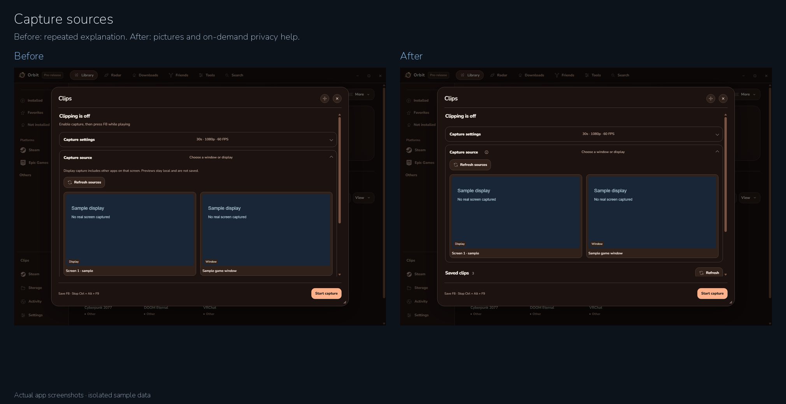
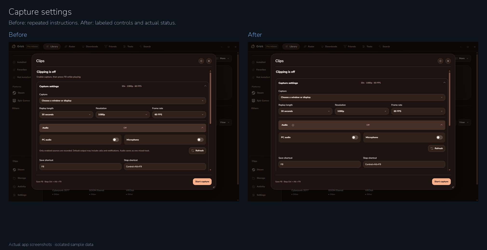

# 0.3.0-dev.8 — less repeated text

Removed persistent taglines and routine how-to paragraphs across Clips, settings, customization, VR, experiments, game details and other menus. Actual status, errors, shortcuts and confirmation warnings remain. Display-capture privacy and audio details are available beside the relevant controls through the info button.

- Before: Clips repeated instructions under its controls. After: the labels and shortcut values do the work.
- Before: popup preferences repeated how dragging and shared sizing work. After: the named controls remain without the extra paragraphs.
- Found during regression checks: changing the keyboard-shortcuts title broke Back to Settings. It now recognizes the shortcuts page independently of its title. The real navigation regression test passes again.

These are actual app screenshots with isolated sample data. The comparison is visual evidence; the checks below separately exercise the controls.

## Checks

779 unit tests passed; two explicit native playtests remain skipped. The final packaged app passed 873 broader checks, plus the focused copy, Clips, audio-layout, source-picker, polish and popup-size checks. All automated app windows stayed hidden and unfocused. Capture and microphone recording were not started.

Privacy help opens on demand; Escape returns focus without closing Clips. Recording progress and genuine error messages still appear. Narrow windows, popup resizing, saved capture choices and repeated open/close behavior passed their fixture checks. Audio encoding and recording quality are unchanged by this copy-only update; the user's earlier successful PC/microphone playtest still applies.

Quiet installation passed. The installed application matches the checked package, including all 33 unpacked resources. Your selected custom theme, seven custom themes, Afterglow intro and 113 history records were retained through the normal preference/history loaders. VRChat stayed running with the same process throughout the update. No CPU or memory improvement is claimed. Nothing was published.

Detailed evidence: `work/copy035-final-suites.json`, `work/copy035-package-verification.json`, `outputs/copy035-review/copy-review-report.json` and the matching focused reports. The first candidate failed Back to Settings; the repaired candidate passed.
