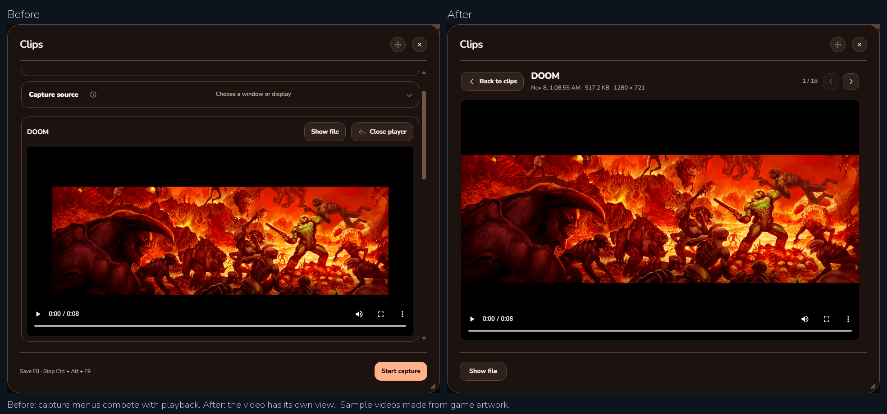
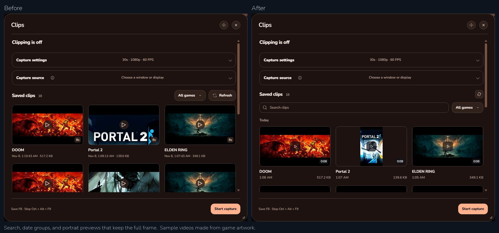

# 0.3.0-dev.9 — clip viewer

Installed locally. Nothing published.

- Larger, focused playback with Previous/Next and a clear **Back to clips** action. The popup keeps its size.
- Search and date groups make saved clips easier to find. Back and Esc retain filters, scroll position, and the selected card.
- Fixed portrait thumbnail cropping. Space plays/pauses; arrows seek; Page Up/Down changes clips.
- Gallery previews release their video sources while watching. Closing playback releases the selected video too. Missing files offer Retry; capture errors and Stop remain reachable while watching.

## Before and after

Before: playback shared space with capture setup. After: the video uses the content area, with navigation above it and Show file below.

Before: portrait previews could crop. After: the complete portrait frame stays visible; search and date groups organize the gallery.

These are actual app screenshots using isolated sample videos made from game artwork, not gameplay recordings. The screenshots show the layout; separate input checks verify behavior.

## What passed

779 unit tests passed; two explicit native playtests remain skipped. The packaged build passed 533 app checks, including 30 focused viewer checks. Playback, seeking, rapid switching, stale-file recovery, filter/scroll/focus restoration, date groups, portrait proportions, corner resizing, narrow windows at 125% scaling, light themes, repeated close/reopen cleanup, and existing capture/audio settings passed. Automated windows stayed hidden and unfocused; recording and microphones were not started.

The first unit run was blocked by Windows file-link and local-server restrictions; the normal-environment run passed. A popup test command initially selected Activity instead of popup sizing; the corrected standalone sizing suite passed. These were test-run issues, not changes to the product.

## Preservation and limits

The installed app matches the checked package and all 33 unpacked resources. The normal preference loader retained the selected custom theme, seven custom themes, Afterglow, saved choices, remembered connection, and 117 history records. Both normal/dev profile locations were checked; only the normal profile existed. Backups are retained locally.

The saved-clip inventory matched before and after installation: 28 video/metadata files had the same names, sizes, and modification times. Video contents were not rehashed. VRChat and Roblox kept the same processes throughout installation. Orbit reopened in the background.

Recorder, audio mixing, capture quality, and recording formats are unchanged. No CPU/RAM gain is claimed without comparable measurements. Native fullscreen and new real-game/audio capture were not visibly playtested in this UI pass; their existing behavior was retained.

Detailed evidence is stored locally in `work/clips038-final-suites.json`, `work/clips038-package-verification.json`, `work/clips038-install.json`, `work/clips038-preservation/`, and `outputs/clips038-packaged/clips-viewer-report.json`.
