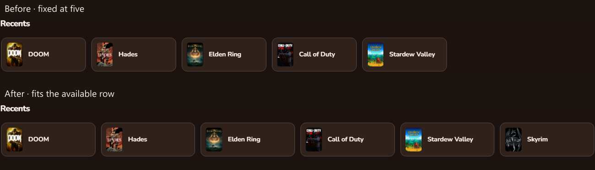

# 0.3.0 candidate review

**Built and installed locally. Not published.** The GitHub release remains a draft pending approval.

## Latest change

Before: Recents stopped at five tiles and left unused space. After: Auto fits the count to the available row, including changes to the details panel and sidebar. A fixed count is still available in Appearance → Layout → Recents. Exclusions and game history stay saved.

Actual hidden-app screenshots with the same sample library, artwork, theme and window size. Sample games are not the user's library.

## Passed

- 829 unit tests; two opt-in native tests skipped.
- 596 packaged checks covering Settings, navigation, popup sizing, clipping, audio, VR software paths and transitions.
- 41 Workspace checks and 17 adaptive Recents checks. These cover both Desktop interfaces, narrow/wide windows, 125% scaling, exclusions, manual counts and keyboard focus. Controller Recents remains unchanged.
- All 370 application source files match the package. Installer SHA-512, size and update configuration match the candidate.
- Visible Setup completed successfully. Installed files match the tested build. The normal preference loader retained the active custom theme, seven custom themes, Afterglow startup, artwork, saved connections and layout choices. No separate dev profile was present.
- User reported closing the games during installation; process exits are not recorded as evidence of an installer regression.

## Release review limits

- User feedback confirmed startup/restart, game launches and physical controller navigation earlier; microphone and PC audio were also reported working. Those checks were not repeated here.
- Live VR click responsiveness and headset readability still need a headset playtest. VR remains experimental.
- Real-game recording compatibility, exclusive fullscreen, sleep/wake, low-space behavior and audiovisual synchronization need broader playtesting. Fixture checks do not establish every game's capture support.
- No comparable performance measurements were taken for this Recents change. It uses width-change notifications rather than polling; this is not a measured RAM/CPU gain.
- The Rust rewrite is a separate preview, not part of this release.
- The public compatibility update feed stays unchanged until publication is approved.

The 0.3.0 optimization priorities remain **all areas**, with existing capture quality and saved settings preserved. Earlier resource findings and limitations are recorded in [dev.20](VALIDATION-0.3.0-dev.20.md); larger card and direct-action checks are in [dev.24](VALIDATION-0.3.0-dev.24.md).

Detailed local records: `work/recents030-unit.log`, `work/recents030-release-suites.json`, `outputs/recents030-ui-packaged/workspace-report.json`, `outputs/recents030-layout-packaged/layout-report.json`, `work/recents030-package.json`, `work/recents030-installation.json` and `work/recents030-preservation/final.json`. These local profiles and credentials are excluded from release files.
