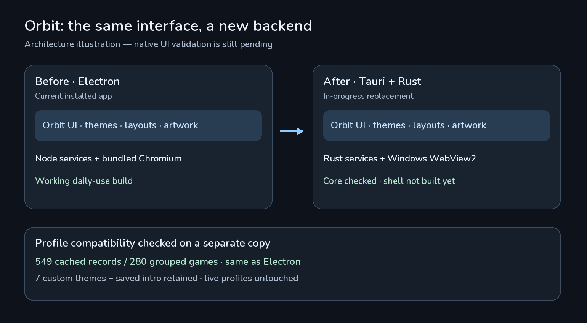

# Rust foundation validation

November 8, 2026. Separate prototype; unpublished and not installed over Orbit.

**Later update:** the C++ tools installation and native Tauri build now succeed. See the [native preview checks and screenshots](VALIDATION-RUST-PREVIEW.md). The record below describes the earlier foundation pass.

**Changed:** started a Rust core and Tauri shell while keeping the existing interface. Rust handles cached library grouping and isolated profile saves. The shell and UI adapter are prepared but have not run natively.

**Passed:** nine Rust tests, including 19 library comparison cases; five static bridge checks; and a read-only comparison of 549 saved records producing the same 280 grouped games as Electron. The comparison checked 18 game fields and ten version fields. Seven custom themes, 24 interface choices and Afterglow remained readable. All three copied profile files stayed unchanged.

**Still needed:** Microsoft C++ Build Tools installation and a native Tauri build. The administrator prompt was canceled; the user chose to finish it later. The portable GNU build failed inside a Tauri dependency. Native UI checks, screenshots, game launches, capture, VR, installers and resource comparisons are unperformed. No performance savings are claimed.

## What the migration keeps

Before: Electron runs Orbit's interface and backend. The intended replacement keeps the interface and moves services into Rust/Tauri. Only the core slice is checked so far. This diagram illustrates the architecture and the saved-profile check; it is not a screenshot or evidence that the Tauri UI runs.

The Rust profile writer preserves unknown fields, validates theme data and storage limits, keeps backups and retains the old file and in-memory state when a save fails. Normal/dev profile paths and their resolved locations are blocked as preview write targets. Credentials and recordings are not opened by this prototype.

## Issues found and fixed during the port

- Different spellings of one Windows folder could become two copies. Repeated separators, parent segments, drive roots and the tested UNC paths now match Electron's results.
- JSON parsing changed the last digit of some decimal values. Exact float parsing now preserves the checked timestamps and achievement percentages.
- Deferred UI scripts could run before the adapter. Preparation now routes all 108 scripts through the adapter, retaining deferred-script ordering. This passes static checks; native behavior still needs testing.

The existing Electron source still matches its reviewed package across 364 checked files. No live profile, game, recording or installed app was changed. Local cached artwork needs a scoped asset service before native UI parity is complete.

[Detailed results](validation/rust-foundation/details.json) · [Migration stages](RUST-MIGRATION.md) · [Prototype build instructions](../rust/README.md)
