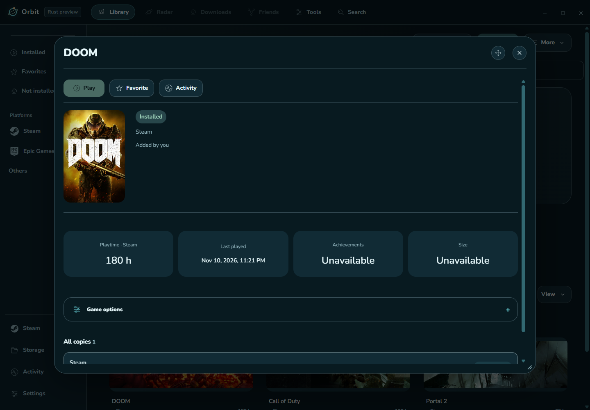
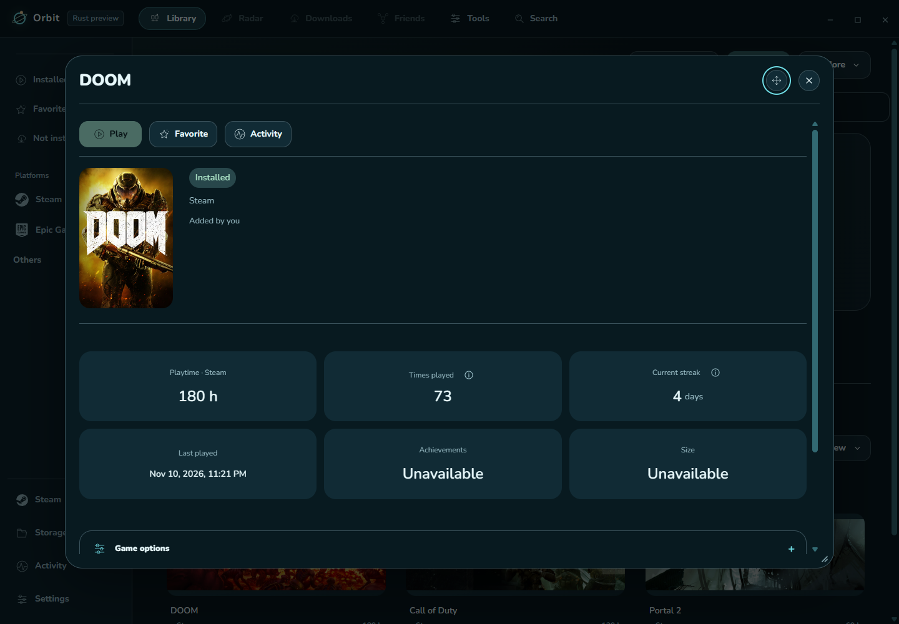
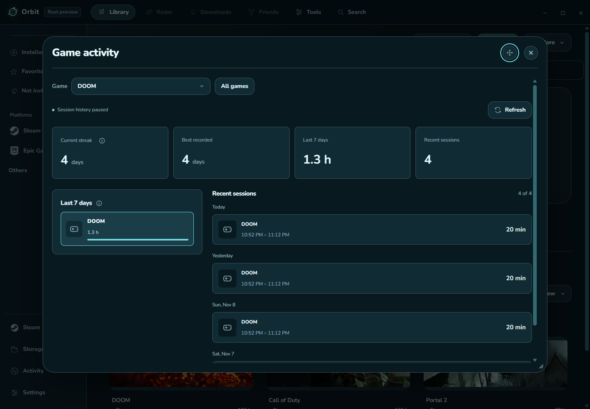

# Rust preview 2: recorded history

November 10, 2026. The rebuild is now the current development priority. Added Rust history reading, Activity timelines, per-game streaks and recorded-play totals while retaining Orbit's interface.

**Passed:** 12 Rust tests, including 30 history and 19 library comparison cases; five static bridge checks; 21 hidden native checks and 25 checks after reopening. A read-only comparison of two saved-history copies matched Electron across 26 game/all-game views. Each copy contains 119 sessions and stayed unchanged. No performance improvement is claimed.

**Still needed:** discovery, launching, live tracking, history editing/recovery, Windows services, accounts, capture/audio, VR and installer/updater migration. The installed app remains dev.12. Preview profiles are isolated; no live profiles, credentials, recordings or game processes were changed by these checks.

## Game details

Before: the Rust preview shows cached platform totals but has no local play count or streak. After: it reads 73 recorded plays and a four-day streak from the sample history. These are actual hidden app screenshots using synthetic history, not a real gameplay test. The existing popup layout is retained; each run also exercises its remembered resize controls.

## Activity works in the native shell

DOOM's Activity shows its four recorded sessions. All games clears the filter and restores all five sample sessions. Nearby observations combine without counting gaps; stored lifetime counts survive history retention. Thirty comparison cases cover these rules, invalid records, weekly boundaries and daylight-saving dates.

[All-games screenshot](validation/rust-preview-2/all-activity.png)

The preview says **Session history paused** because it is not observing games yet. Editing, recovery, recap and news actions remain unavailable here rather than leading to unported services. Reading history does not seed/migrate/write its file, discard recovery data or start a polling loop.

## Checks and limits

- The application window stayed hidden in both native runs. No unexpected JavaScript errors or native shutdown log warnings occurred.
- Saved themes, banners, favorites and popup sizes survived a native process restart. Narrow-window bounds and explicit errors for invalid history requests passed.
- Popup gestures use simulated DOM pointer input. Physical pointer/controller feel and hardware behavior were not tested.
- An initial direct test run hit Windows access errors when using the default temporary directory. The existing build wrapper uses a workspace test directory; all 12 tests passed there. No profile reset or production change was used to make tests pass.
- The copied-history comparison checked both older history without lifetime totals and newer history with them. It did not access credentials or test an account sign-in.

[Evidence summary](validation/rust-preview-2/details.json) · [Migration plan](RUST-MIGRATION.md) · [Earlier native preview](VALIDATION-RUST-PREVIEW.md)
