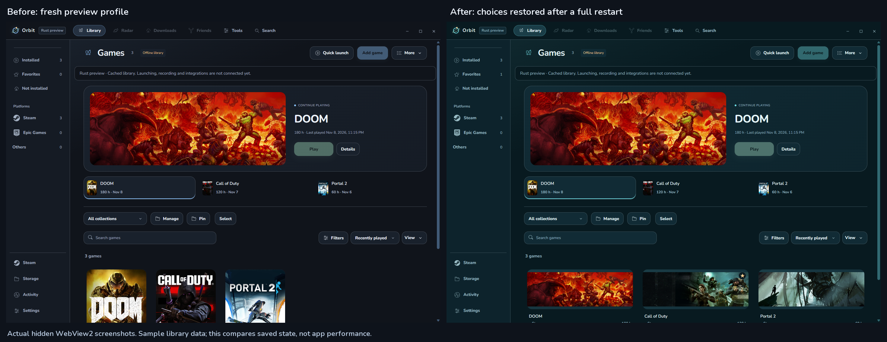
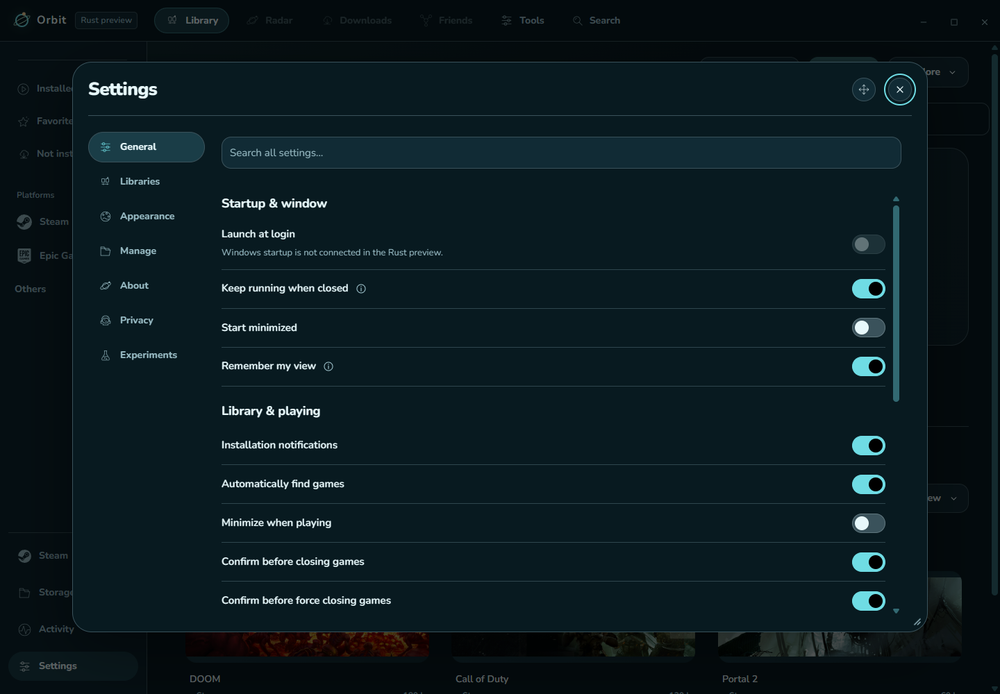
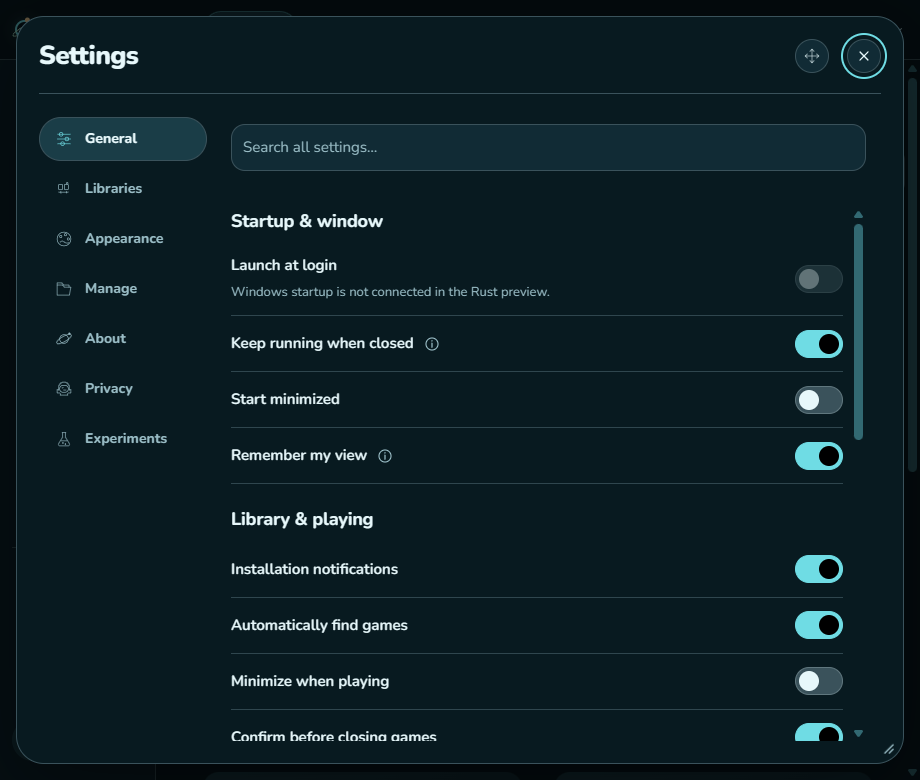

# Rust preview 1 validation

November 8, 2026. Built successfully with Rust/MSVC and Tauri. Kept separate from the installed Electron app; unpublished.

**Passed:** nine Rust tests, 19 library comparison cases, five static bridge checks and 19 hidden native reopen checks. The final WebView2 run recorded no console errors or shutdown warnings, and the native window stayed hidden. The saved-profile comparison still matches Electron across 549 records and 280 grouped games; all three copied files stayed unchanged.

**Not ready to replace Orbit:** launching, discovery, tracking, accounts, clipping, VR and Windows services still need porting. Physical pointer/controller tests, full profile migration, installers/updaters and comparable resource measurements are unperformed. No performance gain is claimed.

## Saved choices survive reopening

Before: a fresh preview profile uses Orbit's default theme and covers. After: Ocean, landscape banners and one favorite return after closing and starting a new native process. These are actual hidden WebView2 screenshots with sample game entries and synthetic playtime, not a comparison of Electron and Tauri performance.

[Fresh screenshot](validation/rust-preview-1/fresh-library.png) · [Reopened screenshot](validation/rust-preview-1/restored-library.png)

## Popups keep the existing design

Settings and game details render in the new shell. Simulated corner-pointer input makes the settings popup wider and saves its size through Rust. A 920 × 780 viewport keeps the frame and close control inside its bounds. Hidden CDP mouse input did not deliver the resize gesture, so these checks use explicit DOM pointer simulation; physical dragging remains untested.

## Findings fixed

- Library data could arrive before the layout modules, leaving cover markup inside a restored banner layout. Initial service requests now wait for UI initialization. The restart check verifies all three landscape images immediately.
- The inherited launch-picker hook requested an unported service in game details. The preview disables that module and unported launch/file controls.
- Corrected the font-preload credentials mode and the preview's inherited Electron wording.
- Fixed a JSON boolean type caught by the native compiler.
- An abrupt fixture exit produced a WebView2 shutdown warning. Closing through the normal window command left the final native log empty.

The C++ tools and Windows SDK installed successfully without a reboot. The separate unsigned debug preview is staged for local review with its own sample profile. It does not replace the daily-use app. Existing Electron source still matches the reviewed package across 364 checked files. Credentials, games, recordings and live profiles were not changed.

[Detailed evidence](validation/rust-preview-1/details.json) · [Earlier core checks](VALIDATION-RUST-FOUNDATION.md) · [Migration plan](RUST-MIGRATION.md)
