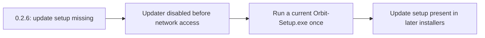

# Update recovery finding

November 8, 2026. Investigated a report that a friend's 0.2.6 copy disabled **Check for updates** and asked them to install Orbit.

**Found:** the archived published 0.2.6 installer lacks `resources/app-update.yml`. The archived 0.2.7 and 0.2.8 installers contain it. All three installers match their recorded SHA-256 checksums. They were inspected as archives and never executed.

Orbit's 0.2.6 startup code disables its updater when that file is missing. The disabled button and message therefore occur before a network check. The friend's exact installation type is unknown, and their computer was not inspected; the known packaging defect matches the report.

**Already fixed:** the current packaging hook retains update configuration, including unpublished and prepackaged builds. No new runtime fix or app installation was needed for this finding.

**Passed:** 25 updater/package tests, including real-driver downloads of a synthetic payload and rejection of an invalid checksum. No installer ran, no game was touched and no native window opened. An initial sandbox run blocked the two localhost download checks; both passed with localhost access.

This is an explanatory diagram of the inspected package behavior, not a screenshot from the friend's computer. Use the [update recovery steps](UPDATES.md). Detailed archive and test evidence is retained in `work/update044-diagnosis.json` and `work/update044-tests-unrestricted.log` in the development workspace.
