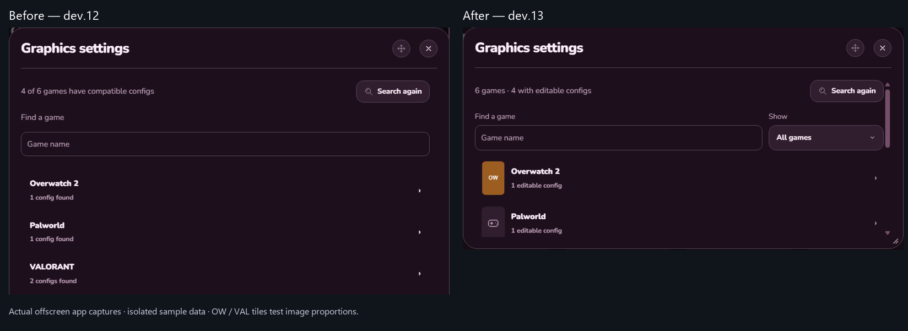
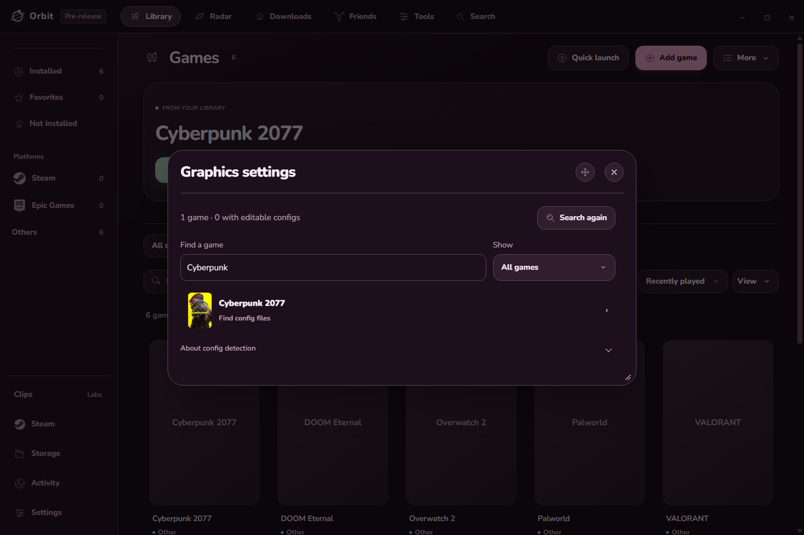
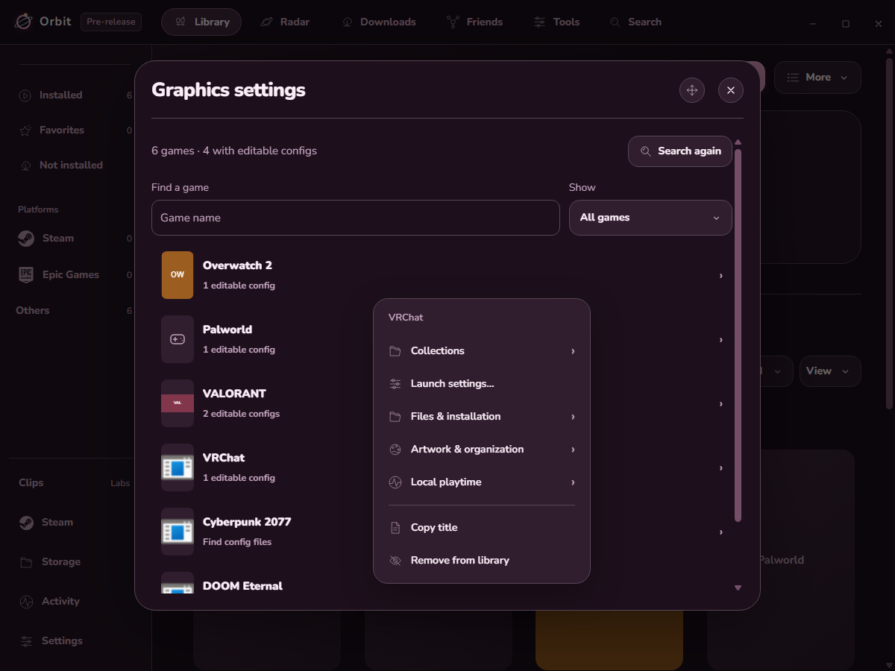
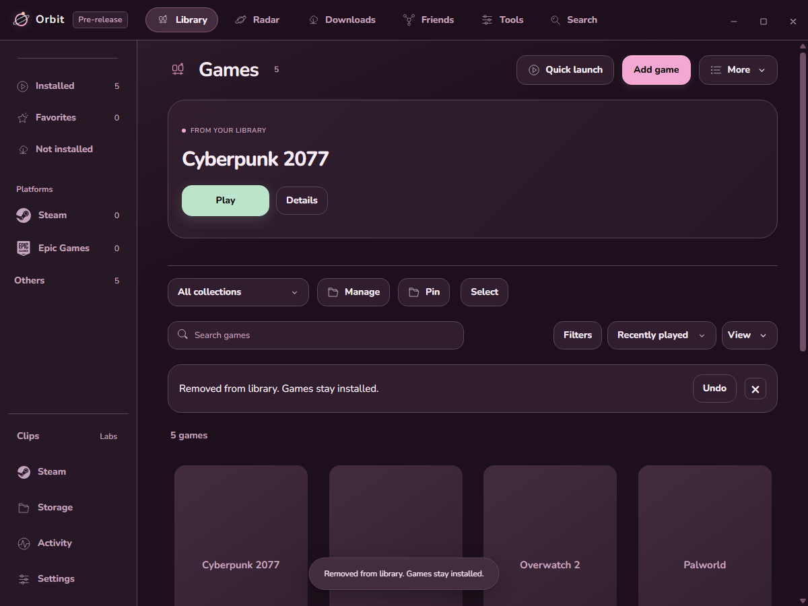
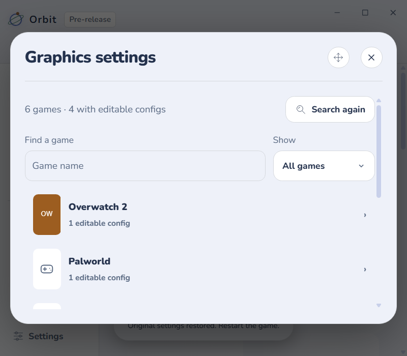

# Graphics games and library removal

Before: game rows were text only and quick misses were labeled as missing compatible configs. After: proportional artwork, Played/All, and Find config files.

These are real app captures using isolated fixture games. OW and VAL are proportion-test tiles, not real cover art. The separate capture below uses existing local Cyberpunk artwork; config results are still isolated sample data.

Right-click a game to remove it from Orbit. The installed game stays untouched. Undo restores it, and Hidden games offers Restore later.

The layout checks also cover a narrow window at 125% scaling. Physical display behavior was not repeated.

