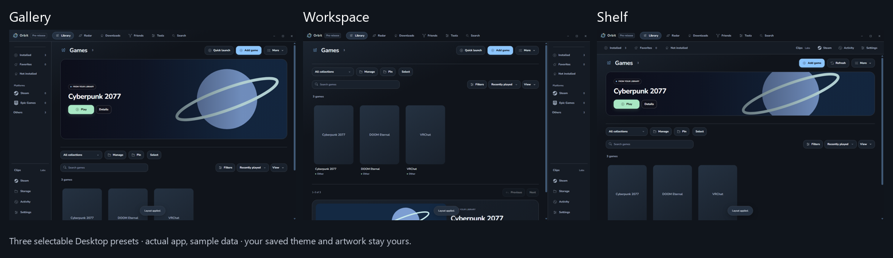
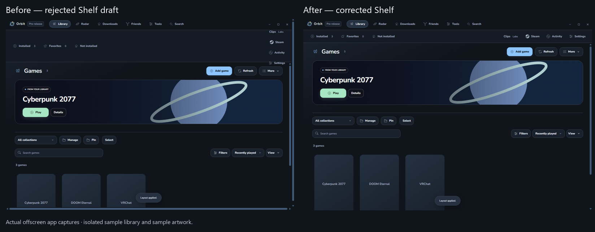
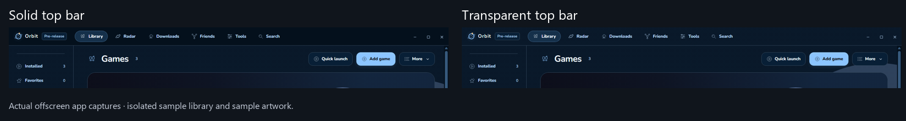

# Desktop layouts

Gallery keeps artwork prominent. Workspace puts games first with navigation on the right. Shelf moves navigation across the top.

Before: Shelf left utilities stacked and a resize handle outside the edge. After: one compact navigation row with contained controls.

The top bar can use the saved theme background. High contrast stays solid; no live blur is used.

All images are actual offscreen app captures with isolated sample games and code-drawn sample art, not the user's library. Live hardware behavior is not established by these screenshots.
