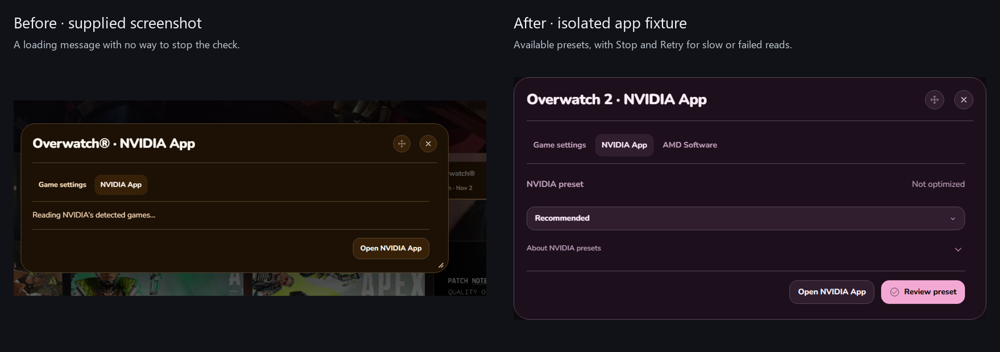
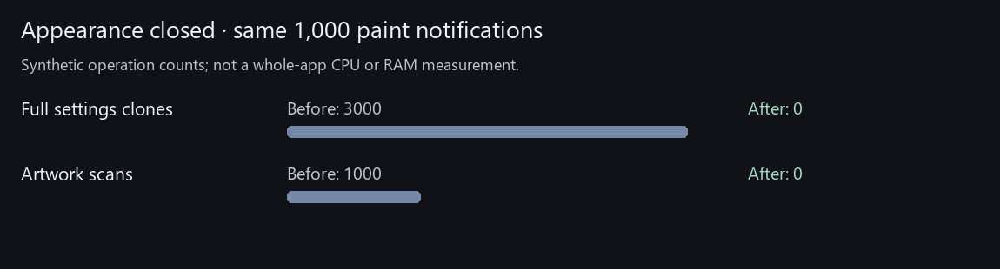

# Before and after

## NVIDIA checks

Before: the supplied screenshot stayed on “Reading NVIDIA’s detected games.” After: the app shows available presets, offers Stop checking during a slow request, and shows Retry after a failure. The new screenshots use isolated sample data; live read-only lookup was checked separately.

[Slow check](nvidia-checking.png) · [Stopped](nvidia-stopped.png) · [Retry](nvidia-retry.png) · [Review](nvidia-review.png)

## Less background UI work

Before: paint notifications cloned all Desktop menu preferences and scanned artwork even with Appearance closed. After: closed Appearance controls skip that work. Mounted controls share one snapshot and one artwork scan. Saved layout choices stay intact.

These are synthetic operation counts, not measured whole-app CPU/RAM gains.
