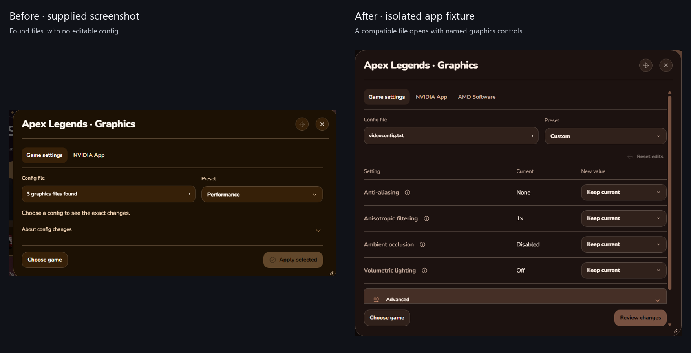
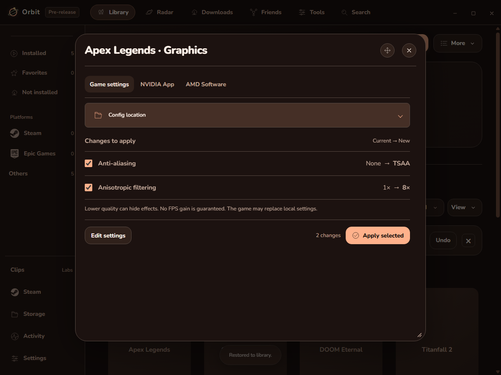
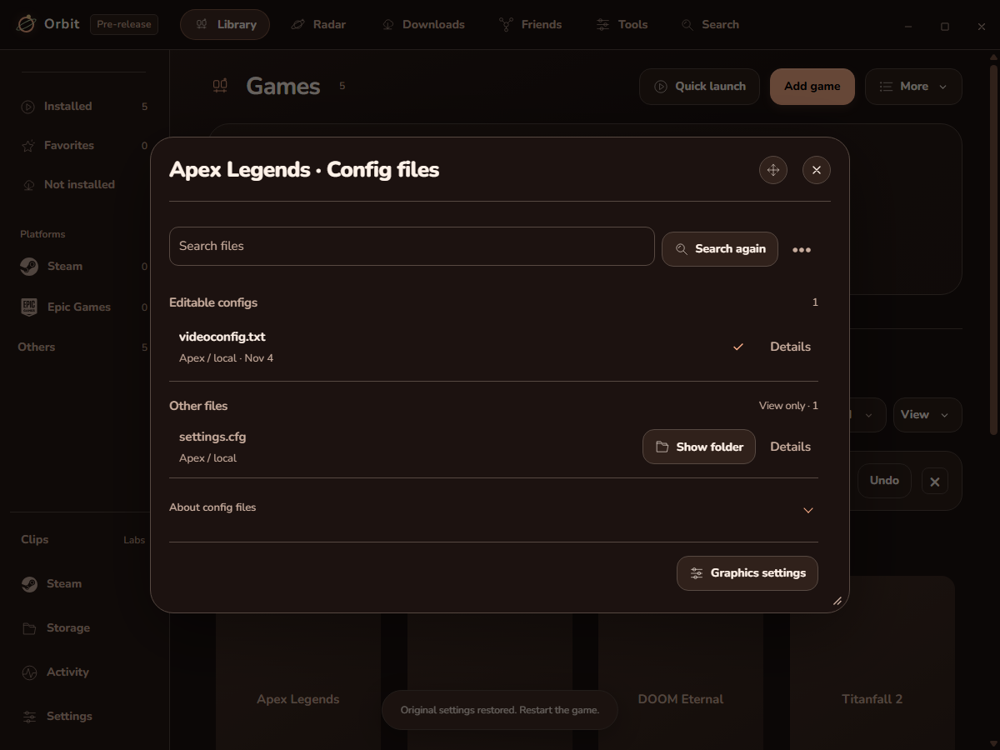
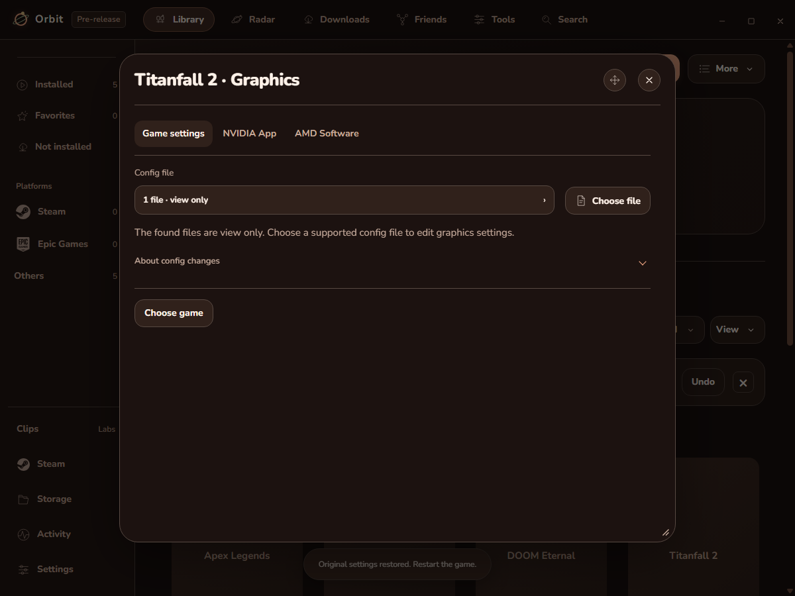
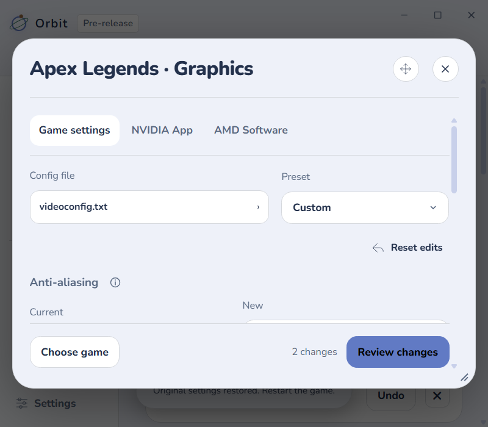

# Before and after

Before: the supplied screenshot listed graphics files but offered no editable config. After: a compatible VideoConfig opens directly in Custom with named current values, choices and Review. The new captures use isolated sample data.

## Review and restore

Before: a compatible file remained view only. After: Review shows only chosen values, such as None → TSAA. Apply edits checked values in the fixture and Restore returns the original bytes. This proves file handling, not the live game’s response.

## Other files

Before: “graphics files found” could imply every file was editable. After: the picker separates editable configs from view-only files. Unsupported-only menus hide unusable preset and Apply controls.

## Narrow windows

The controls stay within the popup at 125% scale, with Review reachable while content scrolls.

