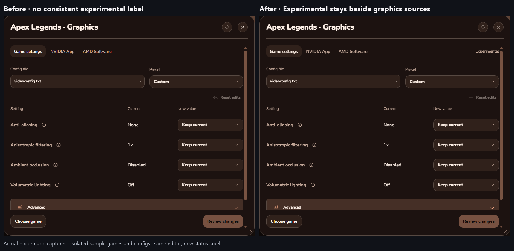
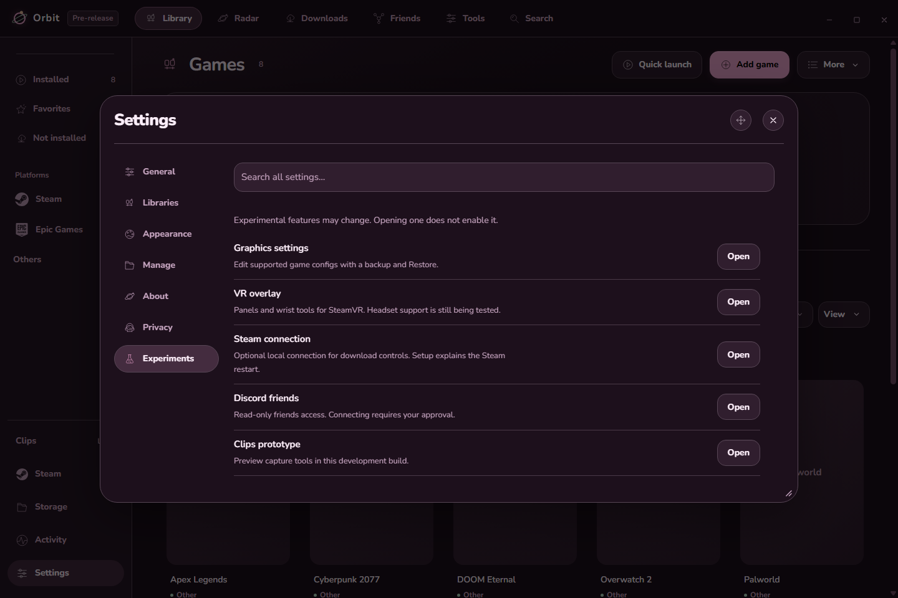
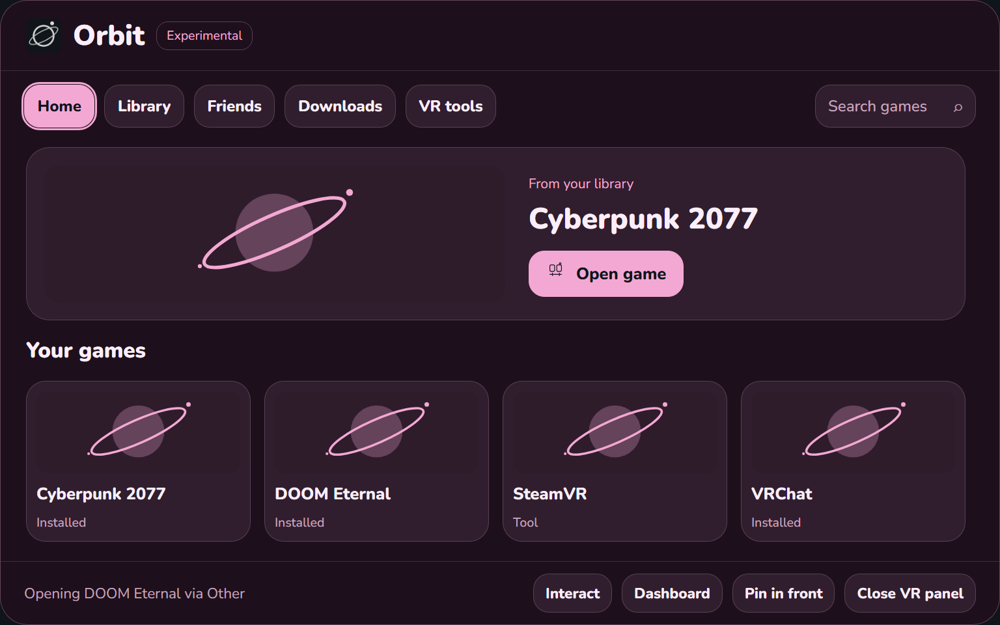

# UI review

These are actual offscreen app captures with isolated sample data. They are not photos through a headset.

## Graphics settings

Before: Graphics settings had no consistent experimental label. After: the game editor and vendor tabs identify the feature as Experimental. Existing config editing, Review and Restore remain available.

## Experiments

More → Experiments opens the matching Settings category. Graphics settings, VR overlay, the optional Steam connection and Discord friends preview have direct routes. The Clips prototype only appears when the build already enables it. Opening this category does not turn on an overlay, capture, connection or config change.

## VR input

Before: dashboard trigger release could be discarded as the end of a nonexistent screen drag. After: the native helper forwards it to the selected button. The automated check exercises the same native button handler and the real offscreen Library tab, search, launch fixture, media and panel tools. Physical headset behavior is untested in this pass.

Detailed counts and settings preservation are recorded in [the check record](evidence-summary.json).
